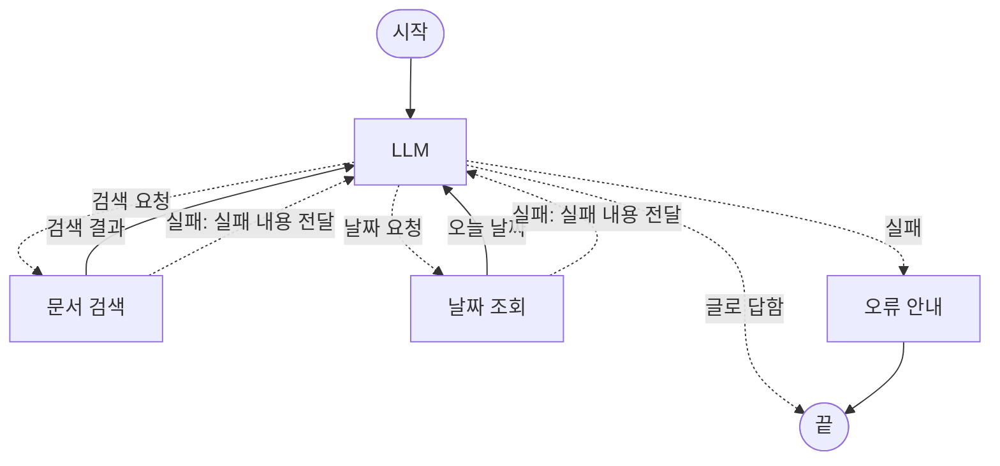
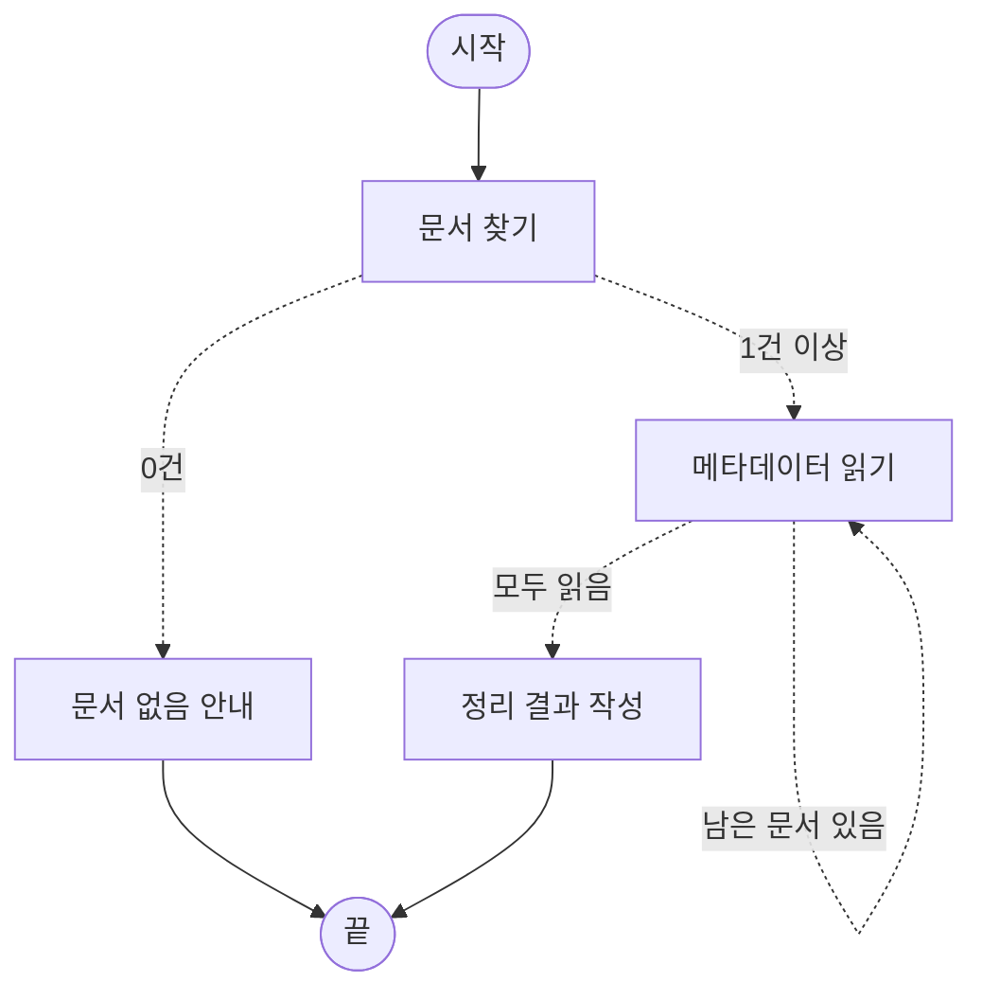

# 아키텍처

## 1. 기술 선택

### 1) Python

- 결정: Python 3.13
- 사유: 선택지가 3.11과 3.13가 있었다. 3.11은 보안 지원 종료까지 1년이 채 남지 않았고, 사용할 라이브러리가 3.13에서 호환성 문제가 없다고 판단했다.

### 2) 그래프 실행 엔진

- 결정: LangGraph 1.2
- 사유: LangGraph를 쓰든 직접 구현하든 유불리가 없음을 확인했다. 그중 LangGraph를 고른 이유는 두 가지다.
  - 면접에서 팀이 LangGraph를 사용한다고 들었다. 팀이 실제로 쓰는 도구로 구현하는 쪽에 가산점을 두었다.
  - 이번 요구사항에 바로 대응하는 기능을 제공한다.
    - 조건부 연결, 순환 연결, 공유 상태 (FR-03, FR-04, FR-05)
    - 노드별 오류 처리기 (FR-06)
    - 실행 옵션으로 주는 전체 단계 수 상한 (FR-04)
    - 노드 실행의 시작과 종료를 순서대로 받는 이벤트 (FR-02)

### 3) LLM

- 결정: 실제 LLM은 호출하지 않고 가짜 LLM(`FakeLLM`)을 쓴다. `FakeLLM`은 LangChain 채팅 모델 인터페이스(`langchain-core`의 `BaseChatModel`)에 맞춰 작성한다. `langchain-core`는 LangGraph를 설치하면 함께 설치된다.
- 사유: LLM을 가짜 구현으로 대체해도 된다고 했고, 시연과 테스트는 API 키 없이 실행되어야 한다. (NFR-02) LangChain의 표준 인터페이스에 맞추면, 필요할 때 실제 모델로 바꿔 끼울 자리가 생긴다.

### 4) 개발 및 실행 환경

- 결정: 개발과 테스트는 uv로 한다. 평가자에게는 Docker로 시연과 테스트를 제공한다.
- 사유: 평가자는 Windows 11에서 README대로 실행한다. Docker로 제공하면 운영체제와 Python 설치 상태에 영향을 덜 받고, 시연 명령 하나와 테스트 명령 하나로 실행할 수 있다. 셸 스크립트나 `make`에 의존하지 않는다. (NFR-01)

### 5) 콘솔 출력

- 결정: Rich
- 사유: 평가자가 시연 출력에서 실행 흐름과 결과를 빠르게 찾을 수 있도록 가독성을 높이기 위해서다. 비교 과정과 결과는 `experiments/console-output/README.md`에 있다. 한글 표시 폭 계산을 제공하고, 색이 표시되지 않는 환경에서는 자동으로 평문을 출력한다. (NFR-05)

## 2. 구성 요소

| 구성 요소 | 하는 일 |
| --- | --- |
| 엔진 | 그래프를 실행하고, 노드마다 실행 기록을 남기고, 노드의 예외와 반복 상한 초과를 실패 결과로 바꿔 돌려준다. 노드 밖에서 난 예외는 그대로 다시 던진다. |
| 노드 | 에이전트 워크플로우의 LLM 노드, 도구 노드(문서 검색, 날짜 조회), 오류 안내 노드와 문서 이력 워크플로우의 문서 찾기, 메타데이터 읽기, 정리 결과 작성, 문서 없음 안내 노드. 각자 맡은 일을 하고 결과를 상태에 쓴다. |
| RAG 검색 | 현행 문서와 보관 문서를 읽어 컬렉션별로 색인하고, 질의와 컬렉션을 받아 관련 문서를 돌려준다. 두 워크플로우가 같은 검색을 쓴다. |
| 가짜 LLM | `FakeLLM`. LLM 노드가 호출한다. |
| 그래프 조립 | 노드와 연결을 엮어 에이전트 그래프와 문서 이력 그래프를 만들고, 노드에 쓸 LLM과 RAG 검색을 넘겨준다. |
| 시연 | 시나리오마다 정해진 그래프와 첫 상태를 엔진에 넘기고, 모든 실행이 끝난 뒤 결과를 Rich로 한꺼번에 출력한다. |
| 로그 | 실행 기록과 예외를 `logs/mini-workflow.log`에 한 줄에 JSON 하나로 남긴다. 화면 출력과 별개이며, 파일을 열 수 없으면 로그 없이 실행한다. |

- 스펙의 "엔진 모듈"은 이 엔진을 가리킨다. 노드 실행, 연결과 조건 따라가기, 상태 전달은 LangGraph가 하고, 엔진은 그 위에서 실행 기록과 실행 결과를 만든다.
- 엔진은 노드의 종류도, 어떤 그래프를 실행하는지도 알지 못한다. 새 노드 타입은 노드를 작성하고 그래프 조립에서 연결하면 실행되며, 새 워크플로우도 그래프를 조립해 넘기면 실행된다. 어느 경우에도 엔진은 고치지 않는다. (FR-07)

## 3. 상태

노드는 다른 노드를 직접 호출하지 않는다. LangGraph가 연결을 따라 노드를 호출하면서 현재 상태를 넘겨주고, 노드가 반환한 값을 상태에 반영한다. 앞 노드가 만든 값은 이렇게 상태를 거쳐 뒤 노드에 전달된다. (FR-05)

상태의 모양은 워크플로우마다 따로 정한다. 두 워크플로우는 서로의 상태를 읽지 않는다.

에이전트 워크플로우:

| 상태에 담기는 것 | 쓰는 노드 | 읽는 노드 |
| --- | --- | --- |
| 메시지 목록: 질문, LLM 응답, 도구 결과 | LLM 노드, 도구 노드, 도구 노드의 오류 처리기, 오류 안내 노드 | LLM 노드, 도구 노드 |
| 실패 정보: 실패한 노드, 실패 원인, 시도 횟수 | LLM 노드의 오류 처리기 | 오류 안내 노드 |

문서 이력 워크플로우:

| 상태에 담기는 것 | 쓰는 노드 | 읽는 노드 |
| --- | --- | --- |
| 주제 | 첫 상태 | 문서 찾기, 정리 결과 작성, 문서 없음 안내 |
| 찾은 문서 목록 | 문서 찾기 | 메타데이터 읽기 |
| 메타데이터 목록: 문서마다 문서 번호, 상태, 시행일, 폐지일 또는 개정일 | 메타데이터 읽기 | 메타데이터 읽기, 정리 결과 작성 |
| 정리 결과 | 정리 결과 작성, 문서 없음 안내 | 시연 출력 |

- 메타데이터 읽기는 실행마다 문서 하나의 메타데이터만 돌려주고, LangGraph의 reducer(`operator.add`)가 이를 기존 목록 뒤에 붙인다. 실행 기록에는 그 실행에서 읽은 문서만 남는다.

## 4. 엔진과 실행 결과

엔진은 그래프를 `stream_mode=["tasks", "values"]`로 실행한다. `tasks`는 노드마다 시작 이벤트와 종료 이벤트(결과 또는 예외 포함)를 실행 순서대로 주고, `values`는 단계마다 전체 상태를 준다. 엔진은 종료 이벤트마다 실행 기록을 한 건 남기고, 마지막으로 받은 전체 상태를 최종 상태로 쓴다.

| 필드 | 내용 |
| --- | --- |
| `status` | 성공 또는 실패 |
| `history` | 실행 기록. 건마다 기록 종류(노드 실행, 오류 처리), 노드 이름, 성공/실패, 노드가 반환한 값, 실패 원인 |
| `state` | 마지막 상태 |
| `stop_reason` | 실행이 중단됐을 때 그 이유. 종류, 노드 이름, 내용을 담는다. |

`stop_reason`의 종류는 중단된 원인에 따라 셋으로 나눈다. 종류가 다르면 대응도 다르기 때문이다. 노드 실패는 노드를 고쳐야 하고, 노드별 상한 초과는 그 노드의 반복 조건이나 상한 값을, 전체 단계 수 상한 초과는 그래프 전체의 흐름을 봐야 한다. 테스트는 문구가 아니라 종류로 원인을 확인한다.

| 종류 | 중단된 경우 | 노드 이름 | 출력 예 |
| --- | --- | --- | --- |
| 노드 실패 | 오류 처리기가 없는 노드가 예외를 던졌다. (FR-06) | 실패한 노드 | `노드 실패 (error_guide, ValueError: ...)` |
| 노드별 상한 초과 | 한 노드의 실행 횟수가 그 노드의 상한을 넘었다. (FR-04) | 상한을 넘은 노드 | `노드별 실행 횟수 상한 초과 (search, 상한 4회)` |
| 전체 단계 수 상한 초과 | 한 실행의 전체 단계 수가 `recursion_limit`을 넘었다. (FR-04) | 마지막으로 실행된 노드 | `전체 단계 수 상한 초과 (llm, 상한 20단계)` |

출력 예는 시연 표의 마지막 줄에 상태 `중단`과 함께 나온다.

시연은 실행 기록을 순서대로 출력한다. 같은 노드가 여러 번 실행되거나 실패해도 실행마다 한 건씩 기록되므로, 모든 노드 실행이 출력에 나타난다. (FR-02)

## 5. 오류 처리 (FR-06)

LangGraph에서는 그래프에 노드를 추가할 때(`add_node`), 그 노드가 실패하면 실행할 함수(오류 처리기, `error_handler`)를 함께 지정할 수 있다. 노드의 실패는 오류 처리기가 지정되어 있는지에 따라 두 가지로 처리한다.

| 경우 | 처리 | 실행 결과 | 해당 노드 |
| --- | --- | --- | --- |
| 오류 처리기가 지정됨 | 오류 처리기가 실패한 노드와 원인을 기록하고, 지정된 노드로 보낸다. | 이어서 실행된다. | LLM 노드, 도구 노드 |
| 오류 처리기가 없음 | 예외가 그래프 밖으로 올라오고, 엔진이 이를 잡아 실패 결과로 바꾼다. | 중단된다. | 오류 안내 노드, 문서 이력 워크플로우의 모든 노드 |

오류 처리기가 지정된 노드는 실패하면 다음과 같이 이동한다.

| 실패한 노드 | 이동하는 곳 | 이유 |
| --- | --- | --- |
| LLM 노드 | 오류 안내 노드. LLM 없이 정해진 틀로 안내문을 만든다. | LLM을 쓸 수 없는 상황이다. |
| 도구 노드 | LLM 노드. 실패 내용을 도구 결과 자리에 넣어 보낸다. | LLM이 사용자에게 안내할 수 있다. 도구 호출 요청에는 결과를 돌려줘야 한다는 실제 API의 규칙과도 맞다. |

- 메타데이터 형식이 맞지 않는 문서(필수 항목이 없거나, 날짜가 `YYYY-MM-DD`가 아니거나, 보관 문서에 폐지일 또는 개정일이 없음)는 실패로 다루지 않고 건너뛰며, 정리 결과에 제외한 문서와 이유를 적는다.
- 노드의 예외는 엔진이 실패 결과로 바꾸고, 노드 밖에서 난 예외는 시연이 질문마다 받아 "실행하지 못함"으로 표시한다. 어느 경우에도 시연은 다음 입력을 계속 실행한다.

### 재시도

LLM 노드에는 재시도(`retry_policy`)를 지정한다. LLM 호출 실패는 연결 요청의 시간 초과나 연결 오류로 가정한다.

| 항목 | 값 |
| --- | --- |
| 재시도할 예외 | `TimeoutError`, `ConnectionError` |
| 총 시도 횟수 | 3번 |
| 대기 시간 | 1초부터 2배씩 늘린다 (1초, 2초) |

- 재시도할 예외는 직접 지정한다. LangGraph의 기본 설정은 `TimeoutError`를 재시도하지 않는다.
- 3번 모두 실패하면 오류 처리기로 간다.
- 재시도 과정은 출력에 따로 표시하지 않는다. 재시도를 모두 실패했을 때, 실패한 노드와 함께 시도 횟수를 표시한다.
- 시도 횟수는 LLM 노드가 실패할 때 `runtime.execution_info.node_attempt` 값을 예외에 붙여 던진다. 실패한 노드가 상태에 쓴 값은 버려지므로 상태가 아니라 예외로 전달한다.

## 6. 반복과 상한 (FR-04)

반복은 조건부 연결이 앞서 실행한 노드를 다시 가리키는 것으로 표현한다. 반복 상한은 두 가지를 둔다.

| 상한 | 세는 것 | 역할 |
| --- | --- | --- |
| 노드별 실행 횟수 상한 | 한 실행에서 노드 이름별 실행 횟수 | FR-04의 "정해진 횟수". 노드마다 다른 값을 준다. |
| 전체 단계 수 상한 (`recursion_limit`) | 한 실행에서 거친 전체 단계 수 | 노드별 상한이 없는 노드까지 포함한 안전장치 |

### 노드별 실행 횟수 상한

- 상한은 노드 이름과 횟수의 묶음(예: `{"search": 4, "llm": 5}`)으로, 엔진의 실행 옵션으로 받는다. 엔진은 노드 이름만 보고 노드의 종류는 알지 못한다. (FR-07)
- 상한을 정하지 않은 노드는 노드별로 제한하지 않고, 전체 단계 수 상한만 적용한다.
- 엔진은 `tasks` 스트림의 시작 이벤트마다 노드 이름별로 횟수를 센다. 어떤 노드의 횟수가 상한을 넘는 시작 이벤트가 오면 스트림을 끊고, 종류가 "노드별 상한 초과"이고 그 노드 이름과 상한을 담은 실패 결과를 돌려준다. 동기 실행(`stream`)에서는 시작 이벤트에서 끊으면 그 노드의 본문이 실행되지 않는다.
- 횟수는 엔진의 실행 함수 안에서 새로 만든다. 같은 엔진으로 여러 입력을 실행해도 앞 실행의 횟수가 이어지지 않는다.
- 상한은 정상 절차의 최대 횟수보다 크게 잡는다. 엔진은 정상 반복과 끝나지 않는 반복을 구분하지 못하고 횟수만 보기 때문이다.

시연의 상한:

| 워크플로우 | 노드 | 정상 절차의 최대 횟수 | 상한 |
| --- | --- | --- | --- |
| 에이전트 | 문서 검색 | 2번 (현행, 보관) | 4 |
| 에이전트 | LLM | 3번 (검색 요청 2번, 답변 1번) | 5 |
| 문서 이력 | 메타데이터 읽기 | 3번 (시연 주제 '배포'에서 찾는 문서 수) | 5 |

- 문서 이력 그래프는 기본적으로 문서 수 상한이 없어, 찾은 문서 수만큼 메타데이터 읽기를 반복한다. 시연의 상한은 시연 주제를 기준으로 잡았다.

### 전체 단계 수 상한

- 엔진의 실행 옵션으로 받아 LangGraph의 `recursion_limit`으로 넘긴다. 기본값은 20이다.
- 상한을 넘으면 LangGraph가 `GraphRecursionError`를 던진다. 엔진이 이를 잡아 종류가 "전체 단계 수 상한 초과"인 실패 결과로 바꾼다.
- K단계로 끝나는 실행에는 K+1 이상의 값이 필요하다.

## 7. RAG 검색 (FR-08)

### 1) 검색 방식

- 결정: 희소 검색(키워드 기반, BM25). 점수 계산은 `rank-bm25` 라이브러리를 쓴다.
- 사유:
  - 재현성: 모델 다운로드나 API 키 없이, 저장소의 문서만으로 어느 환경에서든 같은 결과를 낸다. (NFR-02)
  - 자원과 속도: 임베딩 모델을 불러오고 벡터를 계산하는 데 드는 메모리와 시간이 없다. 문서 30개 규모에서는 색인과 검색이 즉시 끝난다.
  - 결과 안정성: 같은 질의에는 항상 같은 점수와 순위가 나온다. 시연 경로를 자동 테스트로 고정할 수 있다.
- 한국어 문서는 형태소 분석기 없이 문자 2-gram으로 토큰화한다.
- 에이전트 워크플로우의 검색 순서:
  - 문서 검색 노드는 하나이며, 질의와 함께 찾을 컬렉션(현행 또는 보관)을 받는다.
  - 현행 문서를 먼저 찾고, 관련 문서가 없으면 보관 문서를 찾는다. 지금 유효한 정보를 우선하기 위해서다. (FR-04)
  - 검색 결과에는 문서가 속한 컬렉션을 담는다. 보관 문서에서 찾았다는 것을 답변에 알리기 위해서다.
  - 문서마다 질의와 단어가 가장 많이 겹치는 한 줄을 근거 구절로 함께 넘긴다. LLM은 이 구절을 근거로 답한다.
- 문서 이력 워크플로우의 문서 찾기 노드는 현행 문서와 보관 문서를 모두 찾아, 현행 문서의 결과 뒤에 보관 문서의 결과를 이어 붙인다. 지금 유효한 문서와 이전 판을 함께 보여 줘야 하기 때문이다. 찾는 문서 수에 기본 상한은 없고, 그래프를 만들 때 정할 수 있다. 상한을 넘은 문서는 정리 결과에 제외한 문서로 적는다.

### 2) 문서

검색 대상 문서는 가상의 회사 "주식회사 모음소프트"와 그 서비스 "모음보드"의 문서 30개다. AI로 생성했으며, 현행 문서와 보관 문서 두 컬렉션으로 나뉘어 있다.

| 컬렉션 | 내용 | 위치 |
| --- | --- | --- |
| 현행 문서 (`current`) | 지금 유효한 문서 15개 | `data/docs/current/` |
| 보관 문서 (`archive`) | 개정되었거나 폐지되어 보관 처리된 문서 15개 | `data/docs/archive/` |

컬렉션마다 세 주제를 5개씩 담았다.

| 주제 | 현행 문서 예 | 보관 문서 예 |
| --- | --- | --- |
| 사내 규정과 제도 | 연차휴가 및 경조휴가 규정, 재택근무 운영 지침 | 연차휴가 규정 2021년판, 웰니스 포인트 운영 규정 |
| 기술과 운영 | 모음보드 외부 연동 API v2 가이드, 서비스 배포 절차 | 배포 절차 2022년판, 헤르메스 API 연동 가이드 |
| 고객 대상 | 모음보드 요금제 안내, 환불 정책 | 환불 정책 2023년판, 프리패스 이용권 이용 안내 |

- 개정 전 문서는 현행에 같은 주제의 문서가 있어 현행에서 먼저 찾힌다. 폐지·종료 문서는 현행에 같은 주제의 문서가 없다.
- 문서마다 제목 아래에 메타데이터를 둔다. 같은 문서의 현행판과 개정 전 판은 문서 번호가 같다.

  ```text
  # 서비스 배포 절차 (2022년판)

  - 문서 번호: TEC-002
  - 상태: 보관 (개정 전)
  - 시행일: 2022-03-01
  - 폐지일 또는 개정일: 2025-04-30
  ```

  상태는 `현행`, `보관 (개정 전)`, `보관 (폐지)`, `보관 (판매 종료)`, `보관 (지원 종료)` 중 하나다. 폐지일 또는 개정일은 보관 문서에만 있다.
- 폐지·종료된 제도와 상품에는 고유한 이름(예: 웰니스 포인트, 헤르메스 API, 프리패스 이용권)을 붙였고, 현행 문서에는 그 이름이 나오지 않는다.

### 3) 관련 문서 판정 기준

- 결정: BM25 점수가 0보다 큰 문서 중, 질의의 토큰이 문서 제목에도 들어 있는 문서만 관련 문서로 본다. 관련 문서는 BM25 점수 순으로 돌려준다.
- 사유: BM25 점수만으로는 질의의 흔한 말이 우연히 겹친 문서와 실제로 답이 있는 문서를 가를 수 없었다. 검색 대상 문서는 제목이 문서의 주제를 말해 주므로, 질의의 토큰이 제목에 있으면 그 문서의 주제를 묻는 것으로 보고 제목 일치를 판정 기준으로 더했다. 판정 방식별 비교는 `experiments/rag-search/README.md`에 있다.
- 한계: 문서마다 주제가 하나이고 제목이 그 주제를 말해 주는 이 문서 구성에 기댄 규칙이라, 현업 환경에서는 쓰기 어렵다.
- 관련 문서가 없으면 빈 목록을 정상 반환하며, 실패가 아니다.
- 기준은 문서 검색 노드에만 둔다. LLM은 점수를 비교하지 않고, 결과가 있는지만 본다.

## 8. 가짜 LLM (FakeLLM)

실제 LLM은 호출하지 않는다. LLM이 맡는 자리는 `FakeLLM`이 대신하고, 실제 LLM으로 바꿔 끼울 수 있는 자리만 둔다.

### 1) 인터페이스

LLM 인터페이스를 따로 정의하지 않고, LangChain의 채팅 모델 인터페이스(`BaseChatModel`)를 그대로 쓴다. 클라우드 모델과 로컬 모델의 연결 부품이 모두 이 인터페이스를 따르므로, `FakeLLM`도 여기에 맞춰 만들면 같은 자리에 끼울 수 있다.

| | 내용 |
| --- | --- |
| 호출 | `model.invoke(메시지 목록)` |
| 받는 값 | 메시지 목록. 메시지는 사용자 메시지, LLM 응답 메시지, 도구 결과 메시지로 나뉜다. |
| 반환하는 값 | LLM 응답 메시지 하나. 글로 된 답(`content`)이거나 도구 호출 요청(`tool_calls`)이다. |

- LLM은 도구를 실행하지 않는다. 어떤 도구를 어떤 값으로 써 달라고 요청할 뿐이고, 실행은 그래프의 노드가 한다.
- LLM 노드는 이 인터페이스만 사용하고, 어느 구현이 들어왔는지 알지 못한다. 구현은 그래프를 조립할 때 넘겨받는다.

### 2) FakeLLM의 동작

`FakeLLM`은 `BaseChatModel`을 상속해 작성한다. 프롬프트 문장을 해석하지 않고, 메시지 목록의 상태만 보고 응답을 정한다. 위에서부터 먼저 해당하는 규칙을 따른다.

| 메시지 목록의 상태 | 응답 |
| --- | --- |
| 도구 결과가 실패 내용이다 | 실패 원인을 넣은 안내 답변 (글). 다시 검색을 요청하지 않는다. |
| 현행 문서 검색 결과가 있다 | 1위 문서의 근거 구절로 답하고, 끝에 참고 문서의 제목과 식별자를 적는다 (글) |
| 보관 문서 검색 결과가 있다 | 현행 문서와 같이 답하고, 보관 문서라 현재와 다를 수 있다는 안내를 덧붙인다 (글) |
| 현행 문서 검색 결과가 0건이다 | 보관 문서를 대상으로 문서 검색을 다시 요청 (도구 호출 요청) |
| 보관 문서 검색 결과도 0건이다 | 찾지 못했다는 답변 (글) |
| 날짜 조회 결과가 있다 | 오늘 날짜를 넣은 답변 (글) |
| 도구 결과가 없고, 질문에 날짜 키워드가 있다 | 날짜 조회 요청 (도구 호출 요청) |
| 도구 결과가 없고, 질문에 검색 키워드가 있다 | 현행 문서를 대상으로 문서 검색 요청 (도구 호출 요청) |
| 그 밖 | 직접 답변 (글) |

- 같은 입력에는 항상 같은 응답을 낸다.
- 만들 때 지정한 질문에 대해서는, 검색 결과를 받아 답변을 만들 때마다 시간 초과 예외(`TimeoutError`)를 던진다. 재시도해도 매번 실패하므로 오류 안내까지 간다.

### 3) 만들지 않는 것

실제 LLM을 호출하는 구현, 키나 옵션으로 실제 LLM을 켜는 기능은 만들지 않는다. 필요해지면 조립할 때 `FakeLLM` 대신 LangChain의 다른 채팅 모델을 넘기면 되고, 노드와 그래프는 고치지 않는다.

## 9. 워크플로우와 시나리오

시연은 두 워크플로우를 같은 엔진으로 실행한다. 에이전트 워크플로우는 LLM의 응답에 따라 경로가 정해지고, 문서 이력 워크플로우는 LLM 없이 앞 노드가 상태에 쓴 값만 보고 분기하고 반복한다. 성격이 다른 두 그래프가 엔진을 고치지 않고 실행되는 것으로, 엔진이 특정 워크플로우에 묶여 있지 않음을 보인다. (FR-07)

### 1) 에이전트 워크플로우

질문을 받아 LLM이 필요한 도구를 요청하고, 도구 결과로 답한다.



| 노드 | 하는 일 | LLM 호출 여부 |
| --- | --- | --- |
| LLM | 메시지 목록으로 `model.invoke`를 호출하고, 응답을 메시지 목록에 붙인다. | 호출함 |
| 문서 검색 | LLM이 요청한 질의와 문서 컬렉션으로 문서를 실제로 검색하고, 결과를 도구 결과 메시지로 붙인다. 검색은 LLM이 요청하지만, 실행은 이 노드의 검색 코드가 한다. | 호출하지 않음 |
| 날짜 조회 | LLM이 요청하면 오늘 날짜를 도구 결과 메시지로 붙인다. | 호출하지 않음 |
| 오류 안내 | LLM 노드가 실패했을 때, 실패한 노드 이름과 실패 원인을 정해진 틀에 넣어 안내문을 만든다. | 호출하지 않음 |

- LLM 노드 뒤의 조건부 연결은 응답의 종류를 본다. 도구 호출 요청이면 요청한 도구의 노드로, 글이면 끝으로 간다.
- 도구 노드가 끝나면 LLM 노드로 돌아간다. 같은 LLM 노드가 한 실행에서 여러 번 실행되며, LLM이 글로 답하면 반복이 끝난다.

| 입력 | 예상 경로 | 확인하는 요구사항 |
| --- | --- | --- |
| 인사말 | LLM(직접 답변) | FR-03 (경로 1) |
| 오늘 날짜를 묻는 질의 | LLM(날짜 요청) → 날짜 조회 → LLM(답변) | FR-03 (경로 2), FR-07 |
| 현행 문서에 있는 내용을 묻는 질의 (예: 연차휴가 이월) | LLM(검색 요청: 현행) → 문서 검색(현행) → LLM(답변) | FR-03 (경로 3), FR-05, FR-08 |
| 폐지·종료되어 보관 문서에만 있는 내용을 묻는 질의 (예: 웰니스 포인트) | LLM(검색 요청: 현행) → 문서 검색(현행, 0건) → LLM(재요청: 보관) → 문서 검색(보관) → LLM(보관 문서 안내를 덧붙인 답변) | FR-04, FR-09 |
| 현행과 보관 어디에도 없는 내용을 묻는 질의 (예: 사내 동호회 가입) | LLM(검색 요청: 현행) → 문서 검색(현행, 0건) → LLM(재요청: 보관) → 문서 검색(보관, 0건) → LLM(찾지 못했다는 답변) | FR-04 |
| LLM이 시간 초과로 실패하는 질의 | LLM(검색 요청: 현행) → 문서 검색(현행) → LLM(실패: 시간 초과) → 오류 안내 | FR-06 |

### 2) 문서 이력 워크플로우

주제를 받아 관련 문서를 찾고, 문서 번호별 이력과 지금 따라야 할 문서를 정리한다. 첫 상태는 `{"topic": 주제}`다.



| 노드 | 하는 일 |
| --- | --- |
| 문서 찾기 | 주제로 현행 문서와 보관 문서를 검색해 찾은 문서를 모두 찾은 문서 목록에 담는다. 상한을 정했으면 넘는 문서는 제외한 문서로 따로 담는다. 찾지 못하면 빈 목록을 담는다. |
| 메타데이터 읽기 | 찾은 문서 중 아직 읽지 않은 다음 문서 하나의 메타데이터를 읽는다. 형식이 맞지 않으면 건너뛴 문서로 기록한다. |
| 정리 결과 작성 | 메타데이터를 문서 번호별로 묶어 시행일이 최근인 판부터 시행 기간과 상태를 적는다. 마지막 줄에 상태가 현행인 문서를 지금 따라야 할 문서로 적고, 현행 문서가 없으면 마지막으로 유효했던 문서와 효력이 끝난 날을 적는다. 제외한 문서(형식이 맞지 않음, 상한 초과)는 끝에 이유와 함께 적는다. |
| 문서 없음 안내 | 주제의 문서를 찾지 못했다고 적는다. |

- 문서 찾기 뒤의 조건부 연결은 찾은 문서 수를 본다. 0건은 실패가 아니라 정상 결과이며 분기 조건으로 다룬다. (FR-06)
- 메타데이터 읽기 뒤의 조건부 연결은 건너뛴 문서를 포함해 읽은 문서 수와 찾은 문서 수를 비교한다. 같아지면 반복이 끝난다.

| 입력 | 예상 경로 | 확인하는 요구사항 |
| --- | --- | --- |
| 현행판, 개정 전 판, 폐지된 다른 문서가 함께 찾아지는 주제 (예: 배포) | 문서 찾기(3건) → 메타데이터 읽기 ×3 → 정리 결과 작성 | FR-03, FR-04, FR-05, FR-08 |
| 현행과 보관 어디에도 없는 주제 (예: 동호회) | 문서 찾기(0건) → 문서 없음 안내 | FR-03 |

## 10. 출력 (NFR-05)

Rich로 출력한다. 실행 기록은 표로 보여 주고, 각 줄의 결과는 상태 열에 `성공`, `실패`, `오류 처리`, `중단`, `종료` 같은 글자로 먼저 표시한다. 색은 그 글자를 강조하는 데만 쓴다. 분기는 선택된 다음 노드를, 반복은 같은 노드의 몇 번째 실행인지를, 오류 처리는 이동한 노드를 표시한다.
