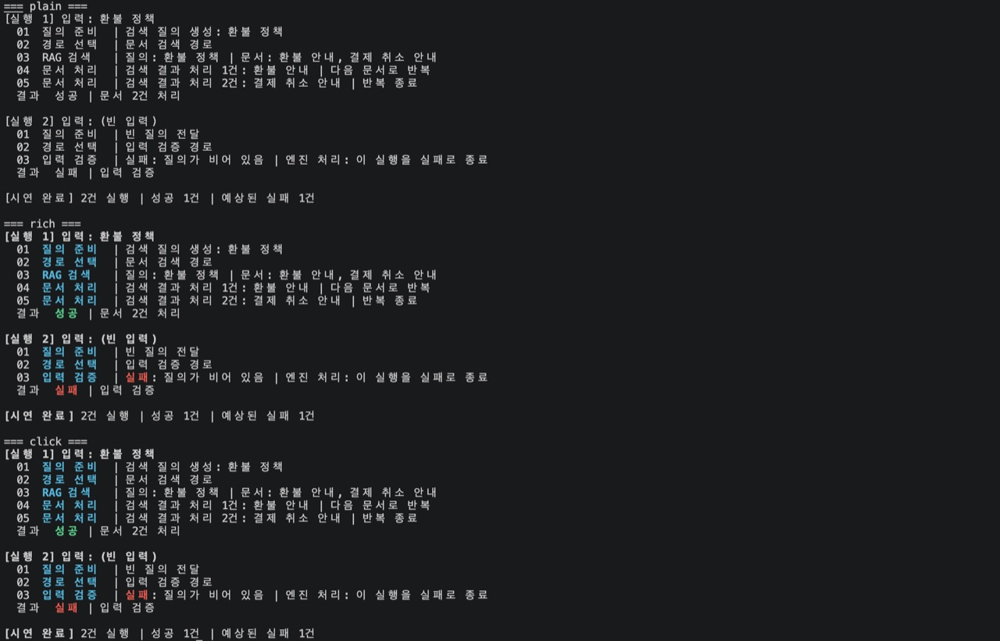

# 콘솔 출력 라이브러리 비교

## 비교 목적

이 프로젝트의 목적은 워크플로우의 실행 흐름을 콘솔로 보여 주는 것입니다. 평가자가 출력에서 실행 결과와 실패 여부를 빠르게 찾을 수 있도록 콘솔 가독성을 높이는 것이 좋다고 판단했습니다. 그래서 콘솔 출력에 색을 입히고, 한글이 섞인 칼럼을 정렬할 수 있는 라이브러리를 AI로 리서치했습니다.

## 후보

리서치에서 나온 Rich, Click, Loguru, 표준 logging, Blessed, prompt_toolkit 중 목적이 같은 세 가지를 남겼습니다.

| 후보 | 선정 이유 |
| --- | --- |
| plain (`print`) | 의존성 없는 기준선 |
| Click | 색만 입히는 가벼운 스타일링 |
| Rich | 색, 정렬, 표까지 지원하는 출력 라이브러리 |

Loguru와 표준 logging은 로그용이라 줄마다 레벨 접두사가 붙고, Blessed와 prompt_toolkit은 인터랙티브 터미널 앱용이라 제외했습니다.

## 결과물 비교

세 후보에 같은 시연 데이터를 넣고, 노드 이름·성공·실패에 같은 색을 입히고 노드 이름 칼럼을 정렬했습니다.



## 실행 방법

저장소 루트에서 실행합니다. 인자 없이 실행하면 세 후보를 차례로 출력하고, 이름을 지정하면 해당 출력만 보여 줍니다.

```text
uv run --project experiments/console-output --locked python experiments/console-output/compare.py
uv run --project experiments/console-output --locked python experiments/console-output/compare.py rich
```

## 최종 선정: Rich

- 색과 정렬 결과는 Click과 같지만, 한글 폭 계산을 라이브러리가 제공합니다. plain과 Click은 한글 폭을 계산하는 헬퍼를 직접 작성해야 했습니다.
- 색이 표시되지 않는 환경(파일 리다이렉션, 파이프)에서는 자동으로 평문을 출력합니다.
- 실행 요약처럼 표가 필요한 출력을 추가로 만들 때 `Table`을 그대로 쓸 수 있습니다.
